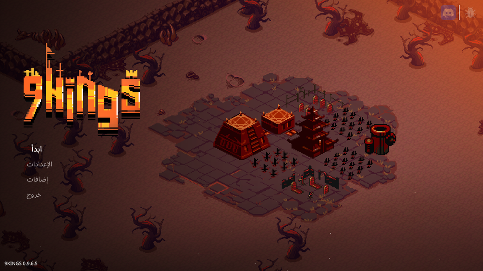
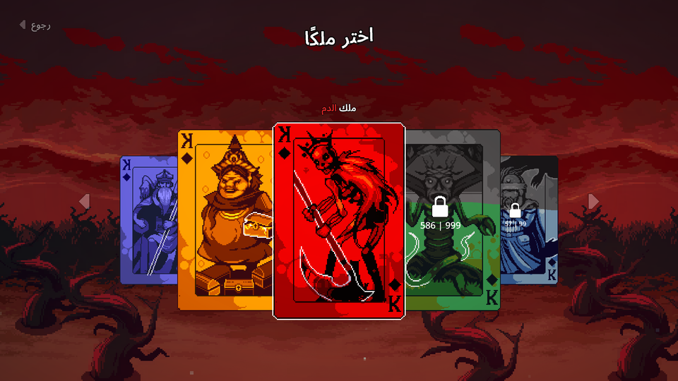
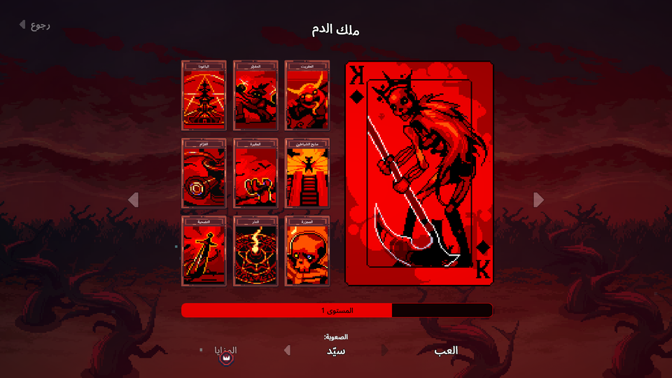
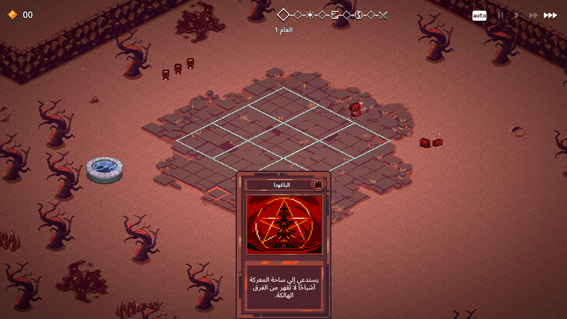

<div dir="rtl">

# ‏9 Kings‎ بالعربية

تعريب كامل للعبة [‏9 Kings‎](https://store.steampowered.com/app/2784470/9_Kings/)،
يغطّي **النسخة الكاملة 1.0.3.1** (بناء Steam رقم 26677340).
يُركَّب بمثبّت، ويحتفظ بنسخة احتياطية من الملف الأصلي، فالإزالة تُعيد اللعبة إلى الإنجليزية
تمامًا كما كانت.

</div>









<div dir="rtl">

## التنزيل

نزّل المثبّت من صفحة **[الإصدارات](../../releases)**:

- ويندوز: `9Kings-Arabic-Windows.exe`
- لينكس: `9Kings-Arabic-Linux`

## التثبيت على ويندوز

1. أغلق اللعبة إن كانت مفتوحة.
2. انقر على `9Kings-Arabic-Windows.exe` نقرًا مزدوجًا.
3. سيبحث المثبّت عن اللعبة في مكتبات Steam ويطبع مسارها، ثم اكتب `1` واضغط Enter.

إن لم يجد اللعبة، اكتب مسار مجلدها أو اسحبه إلى النافذة. لتجد المسار في Steam:
زر الفأرة الأيمن على 9 Kings ← إدارة ← تصفّح الملفات المحلية.

**إن منع ويندوز تشغيل الملف** لأن المطوّر غير موثّق: اضغط **More info** ثم **Run anyway**.
وإن ظهرت رسالة عن الصلاحيات، فانقر على الملف بزر الفأرة الأيمن واختر **Run as administrator**.

## التثبيت على لينكس

الطريقة الأسهل من الطرفية:

</div>

```bash
chmod +x 9Kings-Arabic-Linux && ./9Kings-Arabic-Linux
```

<div dir="rtl">

وإن كنت تعمل بمدير ملفات: انقر على الملف بزر الفأرة الأيمن ← **خصائص** ← **الصلاحيات** ←
فعّل **السماح بتنفيذ الملف كبرنامج**، ثم انقر عليه نقرًا مزدوجًا. وإن لم يفتحه مدير الملفات،
افتح طرفية في مجلد التنزيل واكتب:

</div>

```bash
./9Kings-Arabic-Linux
```

<div dir="rtl">

## تشغيل التعريب

شغّل اللعبة ← الإعدادات (Settings) ← اللغة (Language) ← اختر **Arabic**.

## بعد تحديث اللعبة

تحديث Steam يستعيد الملف الأصلي، فتعود اللعبة إلى الإنجليزية. الحل:

1. نزّل أحدث إصدار من التعريب من صفحة [الإصدارات](../../releases).
2. شغّله؛ سيتعرّف على النسخة الجديدة ويكتب نسخة احتياطية جديدة منها.
3. اختر **Arabic** من إعدادات اللغة إن عادت إلى الإنجليزية.

وإن كان الإصدار المنشور لم يُحدَّث بعد لنسخة اللعبة الجديدة، فسيرفض المثبّت التعديل ويطلب منك
انتظار إصدار جديد؛ لا يمسّ ملفاتك في هذه الحالة.

## الإزالة

شغّل المثبّت نفسه واختر **Uninstall**، فيُعيد الملف الأصلي من النسخة الاحتياطية بعد التحقق منها.
ويمكنك دائمًا استعادة اللعبة من Steam: خصائص ← الملفات المثبّتة ← التحقق من سلامة ملفات اللعبة.

## ما ينبغي معرفته

- **المثبّت لا يحمل أي ملف من ملفات اللعبة.** بل يعدّل نسختك أنت، ويحتفظ بنسخة احتياطية من
  الملف الأصلي قبل أن يمسّه، ويتحقق من النسخة الاحتياطية قبل كتابتها وبعد استعادتها.
- المترجَم **2,077** نصًّا من **2,083**. والستة الباقية صيغ أرقام لا تُترجَم.
- اعتمدت الترجمة على قراءة نصوص اللعبة كاملة وفهم سياقها لا على الترجمة الحرفية،
  والمصطلحات موثّقة في [docs/glossary.md](docs/glossary.md).
- النسخة المدعومة من اللعبة: **1.0.3.1** (بناء Steam رقم 26677340). إن حُدِّثت اللعبة فلن يعدّل
  المثبّت شيئًا، وسيطلب منك انتظار إصدار جديد من التعريب.

## إن لم يظهر التعريب

- **اللعبة ما زالت بالإنجليزية:** تأكد أنك اخترت **Arabic** من إعدادات اللغة داخل اللعبة.
- **المثبّت يقول إن نسخة اللعبة غير مدعومة:** اللعبة أحدث من التعريب؛ نزّل أحدث إصدار،
  أو استعد الملف الأصلي من Steam (خصائص ← الملفات المثبّتة ← التحقق من سلامة ملفات اللعبة).
- **المثبّت يقول إن اللعبة تعمل:** أغلقها تمامًا (تأكد من عدم وجودها في شريط المهام) ثم أعد المحاولة.

## وجدت خطأً؟

افتح [مشكلة](../../issues) واذكر النص كما ظهر وأين رأيته في اللعبة، وأرفق صورة إن أمكن.
وإن ظهر سطر قبل السطر الذي يسبقه داخل صندوق ما، فتلك لوحة لم تُقَس بعد؛ اذكر اسم اللوحة.

## الخطوط والتراخيص

الخط المستخدم [Noto Sans Arabic](https://github.com/notofonts/arabic) مدموجًا مع خط اللعبة
نفسه، برخصة [SIL Open Font License 1.1](fonts/OFL.txt).

شيفرة المشروع برخصة MIT. هذا عمل غير رسمي من المعجبين، ولا صلة له بمطوّري اللعبة
(‏9 Kings‎ © Sad Socket)، ولا يحتوي على أي ملف من ملفاتها.

## للمساهمين

شرح آلية العمل وبنية المشروع في [docs/internals.md](docs/internals.md)، ومنهج الترجمة
في [docs/METHOD.md](docs/METHOD.md)، ودليل المصطلحات في [docs/glossary.md](docs/glossary.md).

</div>
